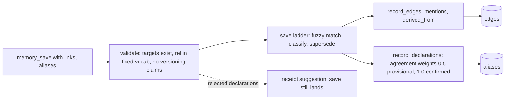
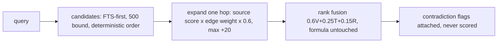

<p align="center"></p>

<p align="center">One durable memory and reusable skills for all your agents.</p>

memo is an MCP server that gives multiple agents shared memory and reusable workflows. One Python process owns the SQLite database (`memo.db`, WAL mode) and is the only writer, exposing eight tools: `memory_search`, `memory_save`, `memory_delete`, `skill_sync`, `skill_get`, `skill_put`, `skill_update`, `skill_install`.

## Quickstart

Prerequisites: Docker (Engine or Desktop) with the Compose plugin.

```powershell
.\install.ps1
```

install.ps1 is idempotent. It writes `.env` with a generated `MEMO_TOKEN`, fetches the embedding weights into `./models` through a temporary container (no local Python), starts the published image from `docker-compose.user.yml`, and prints the health URL. The token lives in `./.env` (gitignored).

To run the three steps yourself:

```sh
docker run --rm -v "$PWD/models:/models" -v "$PWD/scripts:/scripts:ro" -e FASTEMBED_CACHE_PATH=/models ghcr.io/heitorrosa/memo:3.0.0 python /scripts/fetch_model.py
docker compose -f docker-compose.user.yml pull
docker compose -f docker-compose.user.yml up -d
```

The server stores its database in `./data/memo.db` and serves `/health` (unauthenticated) and `/mcp` (bearer token required) on port 5000. For local development, run `pip install .` and start the CLI against an explicit database path; the optional stdio transport is for offline or CI use. Never run two server processes against the same database.

The embedding model (`sentence-transformers/all-MiniLM-L6-v2`, 384 dimensions, loaded by fastembed) is vendored into the gitignored `./models` directory and mounted read-only at `/models`, so builds and container recreates never re-download it. On a fresh clone, populate it once after `pip install .`:

```sh
python scripts/fetch_model.py
```

The container reads weights from the `/models` mount; an empty mount fails loudly instead of silently downloading.

## Configuration

| Variable | Default | Purpose |
| --- | --- | --- |
| `MEMO_TOKEN` | required for HTTP mode | Bearer token for `/mcp`. Send `Authorization: Bearer <token>` (preferred), or `?access_token=<token>` on the `/mcp` URL for clients that cannot set headers; the header wins when both are present. URL tokens leak into proxy and browser logs. |
| `MEMO_LOG` | unset | Set `debug` to log maintenance passes. |
| `MEMO_ENDPOINT` | `http://localhost:8000/mcp` | Server URL used by the OpenCode plugin. |

The CLI also supports port selection, health checks, database backups, and tool-list output.

## Architecture






## Connect a harness

For web harnesses (ChatGPT, Claude.ai), paste [`INSTRUCTIONS.md`](INSTRUCTIONS.md) into the system prompt or instructions field; it is the client-side routine to search first, save durable facts while working, and save outcomes at the end. Remote MCP clients point at `http://localhost:5000/mcp`, and clients that cannot set headers authenticate with `?access_token=<token>`. OpenCode setup and skill sync live in [`opencode-memo/README.md`](opencode-memo/README.md).

## License

GPL-3.0-only. See [`LICENSE`](LICENSE).
