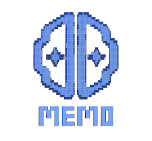
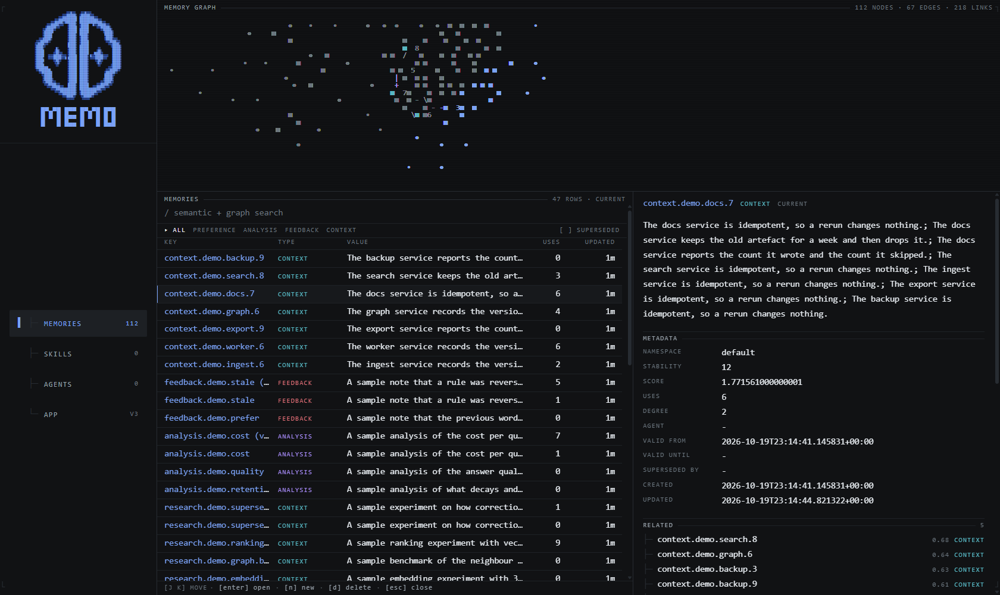
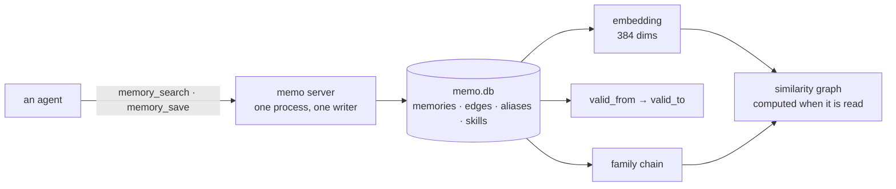
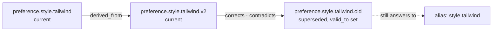

<p align="center"></p>

<p align="center">Durable memory and reusable skills for every agent, with a terminal dashboard to see and edit it.</p>

## What it is

memo is an MCP server. One Python process owns one SQLite file (`memo.db`, WAL mode) and is the only writer to it. Agents call it over MCP and get eight tools: `memory_search`, `memory_save`, `memory_delete`, `skill_sync`, `skill_get`, `skill_put`, `skill_update`, `skill_install`. The image also ships a dashboard where you read and edit what it holds.

## Quickstart

The image ships the server and the dashboard. One command starts it:

```sh
docker run -d --name memo -p 8080:8080 -v memo-data:/data -e MEMO_TOKEN=change-me ghcr.io/heitorrosa/memo:latest
```

Then open <http://localhost:8080/ui/> and paste the token. The dashboard keeps it in the browser, so you type it once. The database lives in the `memo-data` volume and survives container restarts.

On Windows, `.\install.ps1` does the same thing with a generated token: it writes `.env`, pulls the image, starts the container on `./data` and prints the URL.

| command | what runs | published port |
| --- | --- | --- |
| `docker run <image>` | memo server and nginx | 8080 |
| `docker run <image> server` | memo server only | 5000 |
| `docker run <image> ui` | nginx only, proxying to `$MEMO_API` | 8080 |

In the default mode nginx is the public face. It serves `/ui/` and proxies `/api/`, `/mcp` and `/health` to the server on `127.0.0.1:5000`, so the dashboard and the API share one origin and need no CORS. The `ui` mode serves only the dashboard and proxies to another server, named by `MEMO_API` (default `http://127.0.0.1:5000`):

```sh
docker pull ghcr.io/heitorrosa/memo:latest
docker run -d --name memo --restart unless-stopped -p 8080:8080 -v ./data:/data -e MEMO_TOKEN=<from .env> ghcr.io/heitorrosa/memo:latest
```

Never run two server processes against the same database: memo is the single writer, and the server refuses to start when another process holds the file.

## Dashboard

<p align="center"></p>

A terminal app in the browser (Vite, React, TypeScript, Tailwind) served at `/ui/`. The band on top draws the memory graph - the edges you declared plus the correlations the server computes between memories. The panes below are MEMORIES, SKILLS, AGENTS and APP, and the pane on the right is the selected memory: its metadata, its edges, its aliases and the memories it resembles.

| key | action |
| --- | --- |
| `j` `k` | move |
| `enter` | open |
| `n` | new memory |
| `d` | delete, with a confirmation |
| `e` | patch a skill |
| `/` | search |
| `?` | key map |

The app calls the server under `/api/*` with the bearer token: `/api/stats`, `/api/memories`, `/api/skills`, `/api/agents`, `/api/graph`. Read the source in [`ui/`](ui/README.md).

## How the memory works

A memory is one row: a key, a value, a type, an embedding and a life span. The graph is not a separate thing you maintain - it falls out of the memories.



**Saving** embeds the value, writes the row, and records the graph around it: an edge to the parent it revises, an alias for the other name it answers to, and a family id that ties the revisions together.

**Searching** blends the vector similarity of the embedding, the full text match and the decay of stability with age. A hit is reinforced - its use count and stability go up, which is what keeps a useful fact at the top.

**Correcting** is a write, not a guess. When a new value contradicts an old one, the ladder closes the old interval (`status='superseded'`, `valid_to`), points the new row at it (`superseded_by`, `relation_type='corrects'`) and keeps both in one family. The graph draws the conflict, so a reader cannot act on the stale rule.



**Aliasing** lets a fact answer to more than one name: the segment `style.tailwind` points at the canonical key, so an agent can ask for the short name and still land on the right row.

## MCP clients

Point an agent at the server with a bearer token. With the default container the endpoint is `http://localhost:8080/mcp`:

```json
{ "mcp": { "memo": { "type": "remote", "url": "http://localhost:8080/mcp",
  "headers": { "Authorization": "Bearer ${MEMO_TOKEN}" } } } }
```

The OpenCode plugin in [`opencode-memo/`](opencode-memo/README.md) reads `MEMO_ENDPOINT` (default `http://localhost:8000/mcp`) and `MEMO_TOKEN`. Clients that cannot set headers can pass `?access_token=<token>` on the `/mcp` URL; the header wins when both are present, and URL tokens leak into proxy and browser logs. Web harnesses (ChatGPT, Claude.ai) take [`INSTRUCTIONS.md`](INSTRUCTIONS.md) in their system prompt instead.

## Configuration

| Variable | Default | Purpose |
| --- | --- | --- |
| `MEMO_TOKEN` | required for HTTP mode | Bearer token for `/mcp` and `/api/*`. Send `Authorization: Bearer <token>`, or `?access_token=<token>` on the `/mcp` URL for clients that cannot set headers. The header wins when both are present. |
| `MEMO_DB` | `/data/memo.db` | Path of the SQLite file inside the container. |
| `MEMO_API` | `http://127.0.0.1:5000` | Upstream server the `ui` mode proxies to. |
| `MEMO_ENDPOINT` | `http://localhost:8000/mcp` | Server URL used by the OpenCode plugin. |
| `MEMO_LOG` | unset | Set `debug` to log maintenance passes. |

On the host the CLI takes the same paths as flags: `memo --db <path>`, with `--http --port <port>`, `--health <url>`, `--backup <file>` and `--dump-tools`. The optional stdio transport is for offline or CI use.

## The model

Search embeds text with `sentence-transformers/all-MiniLM-L6-v2`: 384 dimensions, loaded by fastembed. The weights are baked into the image, so a plain `docker run` needs no mount. A `/models` bind mount still overrides them.

To pre-fetch the weights for a run outside Docker:

```sh
python scripts/fetch_model.py
```

It writes `./models`. Mount that directory at `/models` to use it in a container.

## Development

```sh
pip install -e ".[dev]"  # runtime and pytest
make ui                  # build the dashboard into src/memo/static/ui
make run                 # docker compose up -d --build, then logs
make docker-build        # build the image
pytest tests/ -q
```

## License

GPL-3.0-only. See [`LICENSE`](LICENSE).
