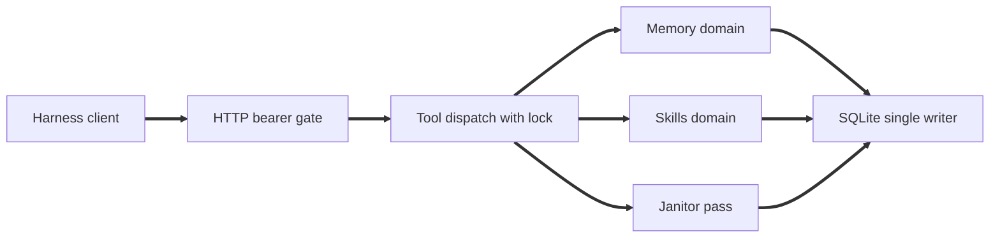
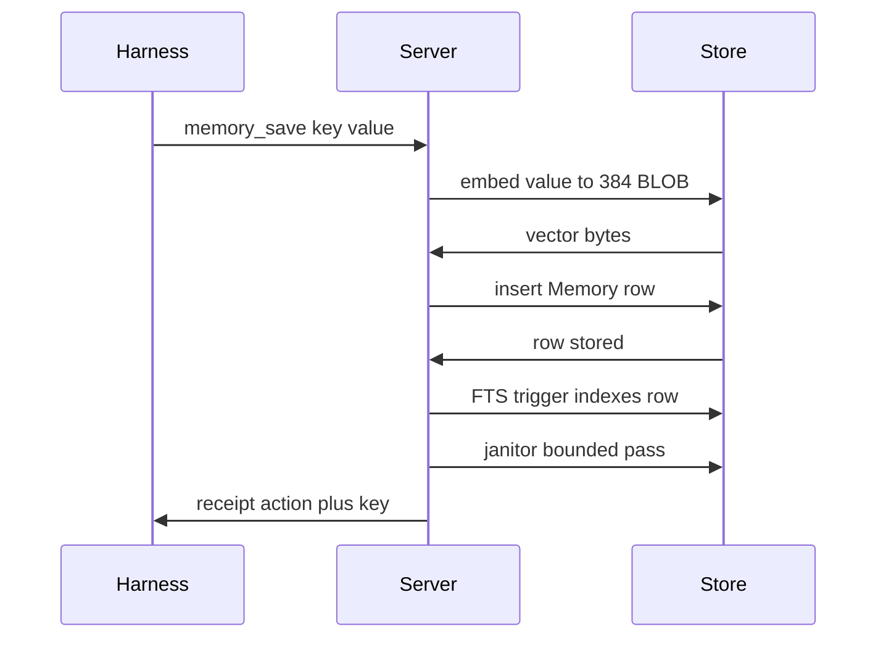
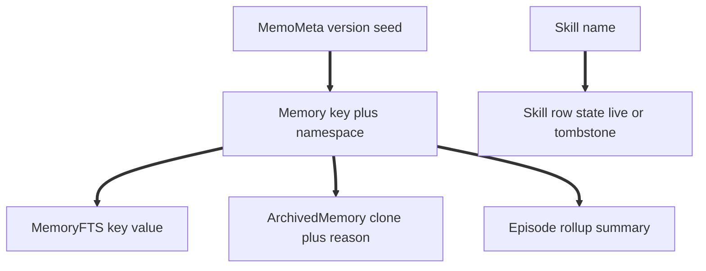

# memo

<p align="center"></p>

<p align="center">One durable memory plus reusable skill MCP server for all of your agents.</p>


memo gives every harness facts the agent remembers and workflows the agent reuses: one Python server over one SQLite file. File harnesses sync skill files; web harnesses hold the skill index bundle in context.
## Architecture
One `memo` container is the sole writer of `memo.db` (WAL mode); every harness is a remote MCP client over Streamable HTTP at `/mcp`. `memory.py` owns facts, ranking, temporal rules; `skills.py` owns index, bodies, deltas. `maintenance.py` runs inline at the end of writes: eviction, archive sweep, context rollup, tombstone expiry. The thin `opencode-memo` Bun plugin does prompt inject, session start sync, after write push, and never opens the DB file.
## Quickstart
Local dev: `pip install .`, then run `memo` with the DB path flag set to `./data/memo.db`. Container run (primary path):
```text
set MEMO_TOKEN to a strong secret in .env (see .env.example)
docker compose up -d with build
docker compose logs memo
```
Serves HTTP on port 8000, DB at `/data/memo.db` (volume `./data`); `/health` is open, `/mcp` requires the bearer token. Backup without downtime: run the memo CLI backup flag against the live container to write a dated copy under `/data`. Fallback stdio transport (offline laptop, CI only): run `memo` with the DB path flag set to the DB file; never run stdio against a DB file the container has open, one writer only.
## Harness wiring
Local opencode (`opencode.json`, replaces the two `hermes` lines):
```json
{ "mcp": { "memo": { "type": "remote", "url": "http://localhost:8000/mcp", "headers": { "Authorization": "Bearer ${MEMO_TOKEN}" } } } }
```
Remote opencode and web harnesses with remote MCP support: same entry with the tunnel URL as url, for example `https://<tunnel-host>/mcp`. Experiments use a quick tunnel to `http://localhost:8000` (random URL, zero config); settled use uses a named tunnel; the tunnel URL is public, so running the HTTP transport without a token is a review blocking bug. Web harnesses without remote MCP use the `skill_sync` bundle plus the `bootstrap` prompt text (paste fallback). Plugin setup, hook order (deletes then writes), and the single truth direction (file and row disagree: the hook overwrites the file, never the row) are in `opencode-memo/README.md`.
## Tools
Eight tools, one prompt, one resource; every tool returns its success receipt or the error envelope `{error, detail}` with `isError:true`, names carry fixed prefixes and never collide with native bare skill tooling. Memory: `memory_search` (call before personal, preferential, or project answers; ranked rows with age and use counts; empty query errors), `memory_save` (one durable fact; ephemeral or trivial input rejected as a success shaped receipt, do not retry; over cap insert adds an archived victim key), `memory_delete` (soft delete only, row moves to archive; missing key returns a not found receipt, not an error). Skills: `skill_sync` (call first each session; file harnesses get write and delete deltas, web harnesses get the index bundle; re call with a filter when truncated), `skill_get` (one full body by name, optional version pin; miss returns the not found error), `skill_put` (create or update, returns hash and version; identical body is a no op with no version bump), `skill_update` (append a dated revision section, never rewrites history), `skill_install` (fetch SKILL.md from skills.sh shorthand or a GitHub repo reference, validate frontmatter, store exactly like skill put). Also the `bootstrap` prompt and `memo://summary` resource return the same text (orientation plus top memories plus skill index plus stats line); forbidden surfaces: skills list tool, skills index resource, bare skill tool, manual touch tool, hard delete path, any background daemon or timer thread.
## System design
Single `memo` container is the sole writer of `memo.db` (WAL, busy timeout 5000); every harness connects as a remote MCP client over Streamable HTTP at `/mcp`. The eight tools (`memory_search`, `memory_save`, `memory_delete`, `skill_sync`, `skill_get`, `skill_put`, `skill_update`, `skill_install`) plus one `bootstrap` prompt and one `memo://summary` resource return the same orientation text (top memories plus skill index plus stats line).
HTTP bearer gate: `/health` is open, every `/mcp` call needs the `MEMO_TOKEN` bearer header. Each tool runs under a shared lock through `server/operations.py`, which maps any exception to the `{error, detail}` envelope and never raises. Envelope codes: `empty_query`, `not_found`, `trivia_rejected`, `cap_evicted`, `hash_mismatch`, `truncated`, `internal`; success shapes are per tool receipts (saved key plus action, ranked rows, deltas, hash plus version).
Persistence: Peewee Models are the schema (`create_tables` creates, `playhouse.migrate` alters, no DDL strings as source of truth). Tables `Memory` (composite key `key` plus `namespace`, CHECKs on type, status, relation), `MemoryFTS` (FTS5 over content `memories`), `ArchivedMemory` (clone plus archive columns), `Episode` (rollup summaries), `Skill` (tombstone is row state `source` equal to `tombstone`, not a table), `MemoMeta` (schema version seed); raw SQL survives only for the `memories_ai`, `memories_ad`, `memories_au` FTS sync triggers plus the archived clone tail. Embeddings are 384 float32 BLOBs; single writer enforced by `BEGIN IMMEDIATE` probe (`db.probe_single_writer`, CLI lock refusal) plus WAL.
Janitor: `maintenance.run` runs one bounded pass (`max_moves` default 5) at the end of `memory.save` and `skill.sync`: (1) over cap eviction per namespace, lowest energy first, victim archived; (2) stale sweep of `analysis` and `context` rows older than threshold with low score and zero uses (`preference` and `feedback` exempt); (3) context rollup older than 30 days into one `Episode` row, sources archived; (4) tombstone expiry older than 30 days, row dropped. Idempotent, silent unless it moved rows.
Memory math. Fusion rank (`rank.py`), order = score desc, uses desc, updated_at desc, key asc:
$$\text{score}=0.6\,V+0.25\,T+0.15\,R,\qquad V=\frac{\cos+1}{2},\qquad T=\text{fts hit}\lor 0,\qquad R=\exp\left(\frac{-age}{S}\right)$$
$$\cos(a,b)=\frac{a\cdot b}{\|a\|\,\|b\|+10^{-12}},\qquad \text{fts}=\min\left(1,\frac{r_{\text{best}}}{r}\right),\qquad age=\frac{\text{now}-\text{created}}{86400}$$
Save ladder (`memory/save.py`): an exact-key hit routes to UPDATE and never supersedes; else the first fuzzy hit with $\text{ratio}(key,candidate)\ge 80$ is classified five ways:
$$\begin{cases}\text{reasserts} & \text{as of YYYY, still, confirm, remains, continues to} & \to \text{touch same row, new } valid\_from\\ \text{extends} & \text{no assert, negation, or additive marker} & \to \text{merge into hit row}\\ \text{qualifies} & \text{additive marker plus word overlap} & \to \text{new row, same } family\_id\\ \text{contradicts} & \text{negation (not, no longer, now, instead, rather than)} & \to \text{supersede hit, new row, supersedes or corrects}\\ \text{unrelated} & \text{additive marker, no word overlap} & \to \text{plain insert, new family}\end{cases}$$
Receipts: `updated`, `created`, `superseded`, `rejected_trivia` (durability gate, success shape, 0 rows); insert uses $family\_id=uuid4$ and $valid\_from$ unclamped (may be future); touch writes set $score=1.1\cdot score$, $uses=uses+1$, $stability=\text{grow}(S,type,age)$.
$$\text{grow}(S,t,a)=\begin{cases}S & \exp(-a/S)<0.05\\ \min\left(S(1+0.3\exp(-a/S)),\;4\,S_{\text{type}}\right) & \text{otherwise}\end{cases}$$
Temporal predicates (`temporal.py`) at $T=\text{now}$ or `valid_at`:
$$\text{is\_effective}=\text{current}\land valid\_from\le T\land(valid\_to=\text{NULL}\lor valid\_to>T)$$
$$\text{in\_window}=valid\_from\le T\land(valid\_to=\text{NULL}\lor valid\_to>T),\qquad \text{started}=valid\_from\le T$$
Janitor energy (`maintenance.py`), victim $=\arg\min$ over grace-passing current rows, tie broken by (created_at, key): $\text{energy}=\frac{uses}{\max(age,1)}\exp\left(\frac{-age}{S}\right)$; $is\_trivia=$ len $<3$, an ack phrase, or a shell dump over 200 chars carrying an exit code; $\text{STABILITY}=\{\text{pref}:14,\text{feed}:10,\text{analysis}:7,\text{ctx}:3\}$; chain_walk = family rows by valid_from.
Constants: $0.6/0.25/0.15=$ WEIGHT V/T/R (rank.fuse); $0.3/0.05/4.0=$ BETA/R_FLOOR/S_CAP_X (grow); $80=$ FUZZ_HIT, clamp $\min(\max(1,limit),50)$, scan LIMIT 500 (save fuzzy scan, search); $250=$ CAP, $1.0=$ GRACE, $0.1/0/90=$ cron score/uses/age, $30/30=$ rollup plus tombstone days (maintenance); $384=$ DIM, all-MiniLM-L6-v2 (embeddings).



## Configuration
Required: `MEMO_TOKEN`, the single bearer token for HTTP; the server refuses to start over HTTP without it, sends it as an Authorization Bearer header on every MCP request, and rotates by restarting the container with a new value. Optional domain flags (read once at startup, values `1`, `true`, or `yes`, case insensitive): `MEMO_DISABLE_MEMORY` (memory tools and the memory half of bootstrap, summary, and maintenance are not registered) and `MEMO_DISABLE_SKILLS` (skill tools and the skill index block are not registered); both set refuses to start with exit code 2 (no domains enabled), and the stats line reports disabled domains as DISABLED. Optional client and log flags: `MEMO_ENDPOINT` (client side default `http://localhost:8000/mcp`), `MEMO_LOG` (`debug`, `info`, or `warn`). CLI surface: DB path flag (required), dump tools flag (prints registered tool names, exits 0, used for stdio versus HTTP parity checks), HTTP flag, port flag (default 8000), health probe flag, backup flag.
## License
GPL-3.0-only. See LICENSE at the repo root for the full text.
