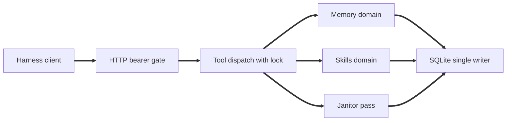
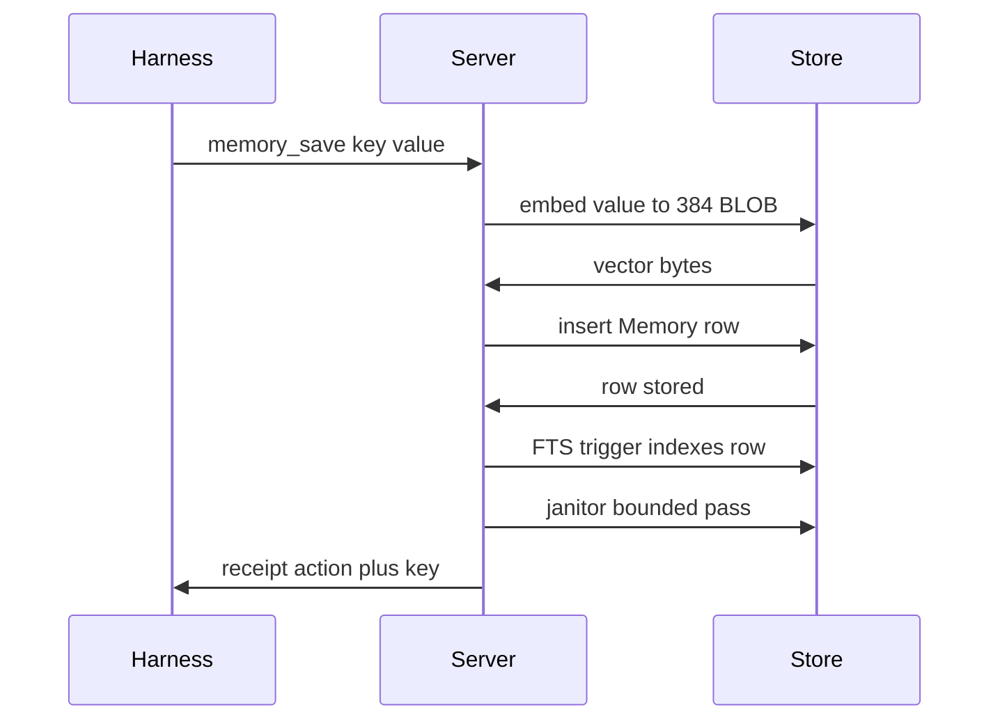
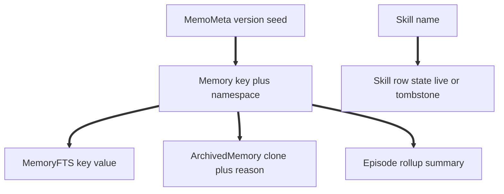

# memo

<p align="center"></p>

<center>One durable memory plus reusable skill MCP server for all of your agents.</center>


memo gives every harness the same two things: facts the agent remembers and workflows the agent reuses. One Python server over one SQLite file. File harnesses sync skill files. Web harnesses hold the skill index bundle in context.

## Architecture

Five lines:

1. One `memo` container is the sole writer of `memo.db` (WAL mode).
2. Every harness is a remote MCP client over Streamable HTTP at `/mcp`.
3. `memory.py` owns facts, ranking, and temporal rules. `skills.py` owns index, bodies, and deltas.
4. `maintenance.py` runs inline at the end of writes: eviction, archive sweep, context rollup, tombstone expiry.
5. Thin `opencode-memo` Bun plugin handles prompt inject, session start sync, and after write push. It never opens the DB file.

## Quickstart

Local dev install:

```text
pip install .
memo with DB path flag set to ./data/memo.db
```

Container run (primary path):

```text
set MEMO_TOKEN to a strong secret in .env (see .env.example)
docker compose up -d with build
docker compose logs memo
```

The container serves HTTP on port 8000 with the DB at `/data/memo.db` (volume mapped to `./data`). Health endpoint is `/health` (no auth). MCP endpoint is `/mcp` (bearer token required).

Backup of the live DB without downtime:

```text
run the backup flag of the memo CLI against the live container to write a dated copy under /data
```

Fallback stdio transport (offline laptop, CI only):

```text
memo with DB path flag set to the DB file
```

Never run stdio against a DB file the container has open. One writer only.

## Harness wiring

Local opencode (`opencode.json`, replaces the two `hermes` lines):

```json
{ "mcp": { "memo": { "type": "remote", "url": "http://localhost:8000/mcp", "headers": { "Authorization": "Bearer ${MEMO_TOKEN}" } } } }
```

Remote opencode and web harnesses with remote MCP support: same entry with the tunnel URL as url, for example `https://<tunnel-host>/mcp`.

Tunnels: experiments use a quick tunnel to `http://localhost:8000` (random URL, zero config). Settled use uses a named tunnel routed to the memo service. The tunnel URL is public, so running the HTTP transport without a token is a review blocking bug.

Web bundle path: harnesses without remote MCP use the `skill_sync` web bundle plus the `bootstrap` prompt text (paste fallback). Plugin setup, hook order (deletes then writes), and the single truth direction (file and row disagree: the hook overwrites the file, never the row) are documented in `opencode-memo/README.md`.

## Tools

Eight tools, one prompt, one resource. Every tool returns its success shape or the error envelope `{error, detail}` with `isError:true`. Tool names carry fixed prefixes and never collide with the native bare skill tooling.

Memory:

* `memory_search`: call before personal, preferential, or project answers. Ranked rows with age and use counts. Empty query returns the empty query error.
* `memory_save`: save one durable fact. Ephemeral or trivial input is rejected as a success shaped receipt, do not retry it. Over cap insert adds an archived victim key.
* `memory_delete`: soft delete only, row moves to archive. Missing key returns a not found receipt, not an error.

Skills:

* `skill_sync`: call first each session. File harnesses get write and delete deltas. Web harnesses get the index bundle. Re call with a filter when truncated.
* `skill_get`: fetch one full skill body by name, optional version pin. Miss returns the not found error.
* `skill_put`: create or update a skill, returns hash and version. Identical body is a no op with no version bump.
* `skill_update`: append a dated revision section to a skill body, never rewrites history.
* `skill_install`: fetch SKILL.md from skills.sh shorthand or a GitHub repo reference, validate frontmatter, then store exactly like skill put.

Also: the `bootstrap` prompt and the `memo://summary` resource return the same text (orientation plus top memories plus skill index plus stats line). Forbidden surfaces that must not exist: skills list tool, skills index resource, bare skill tool, manual touch tool, hard delete path, background daemon or timer thread.

## System design

Single `memo` container is the sole writer of `memo.db` (WAL mode, busy timeout 5000). Every harness connects as a remote MCP client over Streamable HTTP at `/mcp`. Eight tools: `memory_search`, `memory_save`, `memory_delete`, `skill_sync`, `skill_get`, `skill_put`, `skill_update`, `skill_install`. One `bootstrap` prompt and one `memo://summary` resource return the same orientation text (top memories plus skill index plus stats line).

### Request lifecycle

HTTP bearer gate: `/health` is open, every `/mcp` call requires the `MEMO_TOKEN` bearer header. Each tool runs under a shared lock through `server/operations.py`, which maps any exception to the `{error, detail}` envelope and never raises. Envelope codes: `empty_query`, `not_found`, `trivia_rejected`, `cap_evicted`, `hash_mismatch`, `truncated`, `internal`. Success shapes are per tool receipts (saved key plus action, ranked rows, deltas, hash plus version).

### Persistence

Peewee Models are the schema (creation via `create_tables`, changes via `playhouse.migrate`, no DDL strings as source of truth). Tables: `Memory` (composite key `key` plus `namespace`, CHECKs on type, status, relation), `MemoryFTS` (`FTS5Model` over content `memories`), `ArchivedMemory` (clone of `memories` plus archive columns), `Episode` (rollup summaries), `Skill` (tombstone is row state `source` equal to `tombstone`, not a table), `MemoMeta` (schema version seed). Raw SQL survives only for the `memories_ai`, `memories_ad`, `memories_au` FTS sync triggers plus the archived clone tail, applied by `db.migrate` after `create_tables`. Embeddings are 384 float32 BLOBs (`embeddings.py`, offline model fetch failure maps to `internal`). Search fuses vector cosine, FTS text, and retention decay as `0.6V plus 0.25T plus 0.15R` (`rank.py`), ordered by score, uses, recency, key. Temporal validity: `status` equal to `current` plus `valid_from`/`valid_to` window (`temporal.is_effective`), superseded rows stay readable as history (`chain_walk`). Single writer enforced by `BEGIN IMMEDIATE` probe (`db.probe_single_writer`, CLI lock refusal) plus WAL.

### Janitor pass

`maintenance.run` executes one bounded pass (`max_moves` default 5) at the end of `memory.save` and `skill.sync`: (1) over cap eviction per namespace, lowest score first, victim archived; (2) stale sweep for `analysis` and `context` rows older than threshold with low score and zero uses (`preference` and `feedback` exempt); (3) context rollup older than 30 days into one `Episode` row, sources archived; (4) tombstone expiry older than 30 days, row dropped. Idempotent, silent unless it moved rows.

### Diagrams







### Testing

```text
pytest
python scripts/replay_t1_t8.py
```

`pytest` runs the full suite in `tests/` (DB path `src` is already configured in `pyproject.toml`). The replay script replays the eight spec task contracts end to end against a scratch DB. Skill install tests mock the fetch, no live network in CI. Vector tests cover both backends: native vector cosine when present, numpy brute force over the FTS5 prefilter otherwise. Stdio versus HTTP parity uses the dump tools flag output diff.

## Configuration

Required:

* `MEMO_TOKEN`: single bearer token for the HTTP transport. The server refuses to start over HTTP without it. Sent as an Authorization Bearer header on every MCP request. Rotate by restarting the container with a new value.

Optional domain flags (read once at startup, values `1`, `true`, or `yes`, case insensitive):

* `MEMO_DISABLE_MEMORY`: when set, memory tools and the memory half of bootstrap, summary, and maintenance are not registered.
* `MEMO_DISABLE_SKILLS`: when set, skill tools and the skill index block are not registered.
* Both set: the server refuses to start with exit code 2 (no domains enabled). The stats line reports disabled domains as DISABLED.

Optional client and log flags:

* `MEMO_ENDPOINT`: client side default `http://localhost:8000/mcp`.
* `MEMO_LOG`: values `debug`, `info`, or `warn`.

CLI surface: DB path flag (required), dump tools flag (prints registered tool names, exits 0, used for stdio versus HTTP parity checks), HTTP flag, port flag (default 8000), health probe flag, backup flag.

## License

GPL-3.0-only. See LICENSE at the repo root for the full text.
