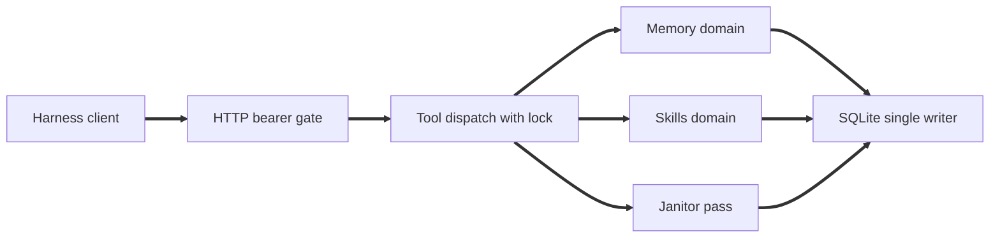
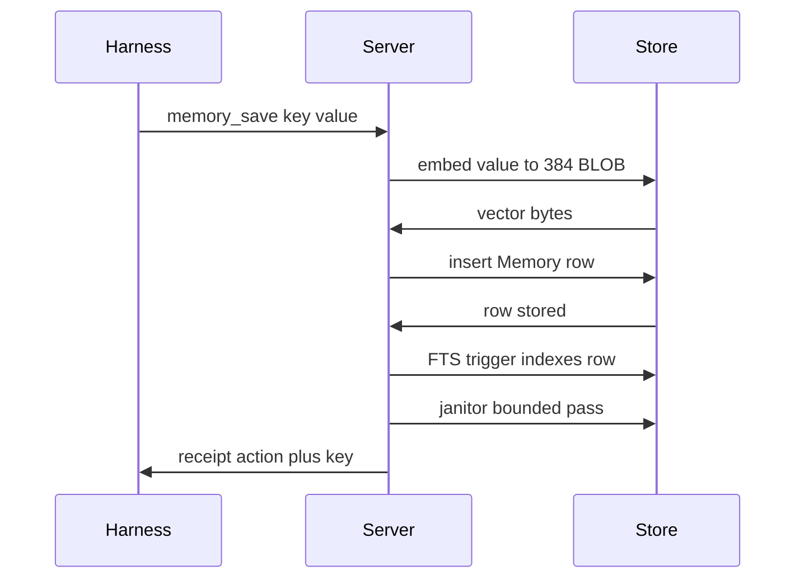
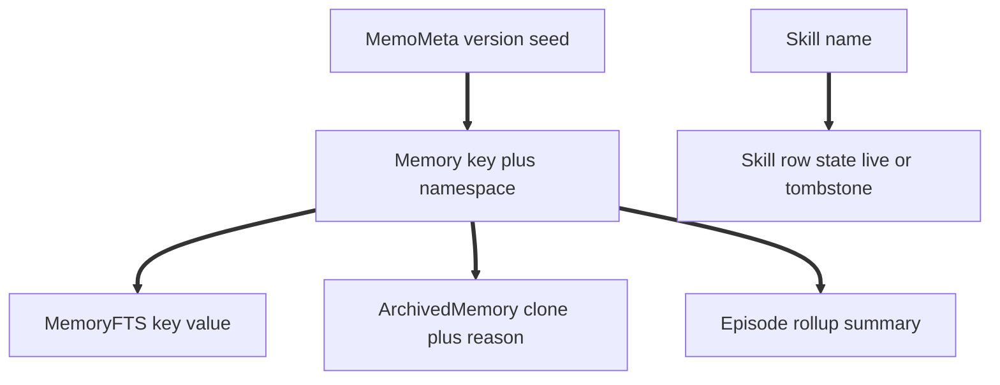

<p align="center"></p>

<p align="center">One durable memory and reusable skills for all your agents.</p>

memo is an MCP server that gives multiple agents shared memory and reusable workflows. A single Python server owns the SQLite database. File-based harnesses sync `SKILL.md` files, while web harnesses can use a skill index in context.

## Architecture

One `memo` container is the sole writer of `memo.db` in WAL mode. Harnesses connect over Streamable HTTP at `/mcp`. The memory domain handles facts, ranking, and temporal rules; the skills domain handles skill bodies, versions, and sync deltas. Bounded maintenance runs after relevant writes. The OpenCode plugin injects memory into prompts, syncs skills at session start, and pushes local skill edits without opening the database directly.

## Quickstart

1. Set a strong `MEMO_TOKEN` in `.env` using `.env.example` as a reference.
2. Start the container:

   ```sh
   docker compose up -d --build
   docker compose logs -f memo
   ```

The server listens on port `8000`, stores its database in `./data/memo.db`, and exposes `/health` and `/mcp`. Health checks are unauthenticated; MCP requests require the bearer token.

For local development, install with `pip install .` and run the CLI with an explicit database path. The optional stdio transport is intended for offline or CI use. Never run multiple server processes against the same database.

The embedding model (`sentence-transformers/all-MiniLM-L6-v2`) is vendored into the gitignored `./models` directory and bind-mounted read-only at `/models`, so builds and container recreates never re-download it. On a fresh clone, populate it once (after `pip install .`):

```sh
python scripts/fetch_model.py
```

Compose points fastembed at the mount (`FASTEMBED_CACHE_PATH=/models`) and sets `HF_HUB_OFFLINE=1`, so the server reads the weights from `./models` and fails loudly rather than silently downloading if the mount is empty.

## Connect a harness

Add Memo as a remote MCP server in `opencode.json`:

```json
{
  "mcp": {
    "memo": {
      "type": "remote",
      "url": "http://localhost:8000/mcp",
      "headers": {
        "Authorization": "Bearer ${MEMO_TOKEN}"
      }
    }
  }
}
```

For remote clients, replace the URL with a reachable HTTPS endpoint and keep authentication enabled. See [`opencode-memo/README.md`](opencode-memo/README.md) for plugin setup and sync behavior. Harnesses without remote MCP support can use the `skill_sync` bundle and `bootstrap` prompt as a fallback.

## Tools

### Memory

- `memory_search` retrieves ranked memories. Use it before answering personal, preference, or project-specific questions.
- `memory_save` stores a durable fact and classifies it as an update, extension, qualification, contradiction, or new fact. Trivial or ephemeral input is rejected with a receipt.
- `memory_delete` soft-deletes a memory and archives the row.

### Skills

- `skill_sync` retrieves file write/delete deltas or the skill index. Call it at session start and repeat with a filter if the response is truncated.
- `skill_get` fetches a skill body, optionally at a specific version.
- `skill_put` creates or updates a skill and returns its hash and version. Identical content does not create a new version.
- `skill_update` appends a dated revision without rewriting prior history.
- `skill_install` imports a `SKILL.md` from a skills.sh shorthand or GitHub reference.

The `bootstrap` prompt and `memo://summary` resource provide session orientation, top memories, the skill index, and a stats line. Errors use a structured `{error, detail}` response.

## How it works

A single server authenticates MCP requests, dispatches memory and skill operations, and writes to SQLite. Maintenance runs as a bounded pass after relevant operations.



A memory save embeds the value, stores the memory, lets the full-text index update, then runs bounded maintenance and returns a receipt.



SQLite stores live memories, full-text search data, archived rows, episode summaries, and skill state. Skill deletions are represented as tombstones until they expire.



- **Memory:** combines semantic similarity, full-text matching, and retention. Memories support temporal validity, supersession, and archiving.
- **Skills:** stores skill bodies and versions, and tracks file deltas and tombstones for synchronization.
- **OpenCode plugin:** injects memory, syncs skills at session start, and pushes local skill edits after writes.
- **Maintenance:** evicts low-value memories when over capacity, archives stale context, rolls older context into episode summaries, and expires old tombstones.

!
## Configuration

Required:

- `MEMO_TOKEN`: bearer token for HTTP MCP requests. Send it as an `Authorization: Bearer <token>` header (preferred), or — for clients that cannot set headers, such as ChatGPT custom MCP — as the `?access_token=<token>` query parameter on the `/mcp` URL. If both are present the header wins. URL tokens are less safe: they leak into proxy, gateway, and browser logs, so use the header wherever the client supports it.

Optional:

- `MEMO_DISABLE_MEMORY=1`: disable memory tools and related summary content.
- `MEMO_DISABLE_SKILLS=1`: disable skill tools and the skill index.
- `MEMO_ENDPOINT`: client endpoint, default `http://localhost:8000/mcp`.
- `MEMO_LOG`: log level, `debug`, `info`, or `warn`.
- `MEMO_TRUSTED_HOSTS`: optional tightening of the `/mcp` `Host` allowlist. By default every `Host` is accepted — the bearer token is the security boundary (mandatory, constant-time, 401 before dispatch), and `Host` validation is only DNS-rebinding defence-in-depth that would otherwise break on every tunnel rotation (trycloudflare/funnel hostnames change per restart). `Origin` stays gated to localhost by default, so browsers are still origin-gated. Set this to a comma-separated list (e.g. `memo.example.com`) to restrict `/mcp` to exactly those hosts plus localhost; each entry is also allowed with any port.

Boolean flags also accept `true` or `yes`, case-insensitively. Both domains cannot be disabled at once. The CLI supports HTTP mode, port selection, health checks, database backups, and tool-list output for transport parity checks. Backups can be made while the server is running using the CLI backup command.

## TODO

- [ ] Graph links for the memories and skills
- [ ] Skill Janitor
- [ ] Retrieval gate to force the memory to be read using a System1 Decision model
- [ ] Management dashboard

## License

GPL-3.0-only. See [`LICENSE`](LICENSE).